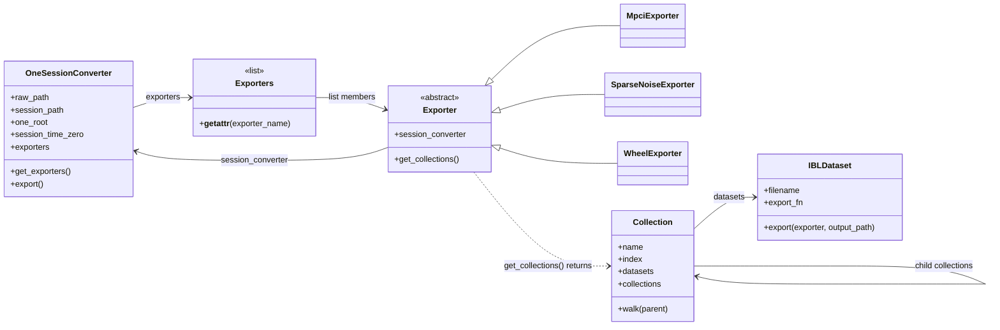

# ALF Toolbox

`OneSessionConverter` turns acquisition files into IBL standard datasets. It writes a local session using ALF (ALyx File) names. The **Open Neurophysiology Environment (ONE) API**, supplied by the read-only `ONE/` checkout, searches and loads those datasets through `one.api`.

## 1. Convert and load a session

Install this project and the local ONE API from the repository root:

```powershell
python -m pip install -e ./ONE
python -m pip install -e .
```

The example below uses the NM023 session. Replace the subject, date, session number, and three root paths for your data. The raw session is expected at `raw_data_root / modality / subject / YYYYMMDD / session_number` and needs `timestamped_digital.csv`. Processed Suite2p data are found under `processed_data_root / modality / subject` when available.

```python
from alf_toolbox import OneSessionConverter, explain_dataset
from one.api import One, make_parquet_db

session = OneSessionConverter(
    "2P",                       # acquisition modality
    "NM023",                    # subject
    "20260428",                 # date: YYYYMMDD or YYYY-MM-DD
    1,                          # session number
    raw_data_root="//10.233.25.135/FANCiNAS1/Data",
    processed_data_root="//10.233.25.135/FANCiNAS1/Processed",
    converter_root="D:/alftoolbox",  # where converted sessions will be written
)

# See which exporters are available and their current settings.
print(session.exporters)

# Example: reassign an exporter's default setting before conversion.
session.exporters.SparseNoiseExporter.sparse_noise_shapes = ((15, 15), (10, 30), (7, 27))
session.export()

# Refresh ONE's local index after writing the session.
make_parquet_db(session.one_root, hash_files=True)
one = One(session.one_root, mode="local", wildcards=False)

# Find the converted session. ONE calls its session identifier an EID.
eid = one.search(
    subject=session.subject,
    date_range=session.date,
    number=session.session_number,
)[0]

# See what this session contains.
datasets = one.list_datasets(eid)
collections = one.list_collections(eid)
print(datasets)
print(collections)

# Load one dataset, one ALF object, or a whole collection.
wheel_times = one.load_dataset(eid, "alf/_ibl_wheel.timestamps.npy")
wheel = one.load_object(eid, "wheel", collection="alf")
fov = one.load_collection(eid, "alf/FOV_00")
print(wheel_times.shape, wheel["position"].shape, list(fov))

# Print the definition of any dataset supplied by this project.
explain_dataset("alf/_ibl_wheel.timestamps.npy")
```

The `sparse_noise_shapes` assignment above uses the exporter's exact default values, so the example preserves its usual behavior. For another recording, set this only when you know its grid size. `one.load_dataset` loads a single file; `one.load_object` groups attributes of an ALF object, such as wheel timestamps, position, and velocity; `one.load_collection` loads the objects in a directory such as `alf` or `alf/FOV_00`. Use `list_datasets` and `list_collections` to find the names available in another session. `explain_dataset` also accepts a filename alone, such as `"mpci.times.npy"`, and prints its units, type, dimensions, and description. It does not need a converter instance.

For NM023, the converted files are placed under `D:/alftoolbox/2P/NM023/2026-04-28/001/`. `session.session_path` holds that directory, and `session.one_root` is the directory passed to ONE. Rebuild the local index with `make_parquet_db` after another export so ONE sees the new files.

## 2. How this project works

The package's own classes are shown below. ONE reads the files they produce.



1. `OneSessionConverter` in [`core.py`](core.py) builds the source and output paths for one session and reads the session time zero from `timestamped_digital.csv`. It writes under `converter_root / modality / subject / YYYY-MM-DD / NNN`.
2. [`exporters/__init__.py`](exporters/__init__.py) discovers concrete `Exporter` subclasses in the `exporters/` Python files. The converter creates each exporter and retains those whose `get_collections()` finds matching source data. `session.exporters` is an `Exporters` list; it also supports access by class name, for example `session.exporters.WheelExporter` when wheel data are present.
3. Concrete exporter classes declare `settings` defaults and a class-level `datasets` map of `IBLDataset` definitions. The base `Exporter` copies the setting values onto each instance and stores its `session_converter` reference. `get_collections()` builds and returns `Collection` objects; the base exporter does not store them. A collection references selected dataset definitions and can have child collections, giving paths such as `alf/FOV_00`. An `IBLDataset` holds the filename parts, documentation, and a module-level export function.
4. `session.export()` asks the retained exporters for their collections again, records those collections on the converter, walks their dataset definitions, creates output directories, and calls each dataset's export function. It returns the paths written. Exporter settings can be changed on the retained instance before this call.

The current exporters are [`MpciExporter`](exporters/mpci.py) for Suite2p imaging results, [`SparseNoiseExporter`](exporters/sparse_noise.py) for receptive field mapping files, and [`WheelExporter`](exporters/wheel.py) for rotary encoder data. They create IBL named files in `alf/`, `alf/FOV_XX/`, or `raw_passive_data/` as appropriate. `explain_dataset` looks up the documentation stored in their dataset definitions.

## 3. Add an acquisition exporter

Create **one new `.py` file** in `exporters/`, for example `camera.py`. The module must contain:

1. **Module-level export functions.** Define one function per dataset with the signature `export_something(exporter, output_path: Path) -> Path`. Read from `exporter.session_converter.raw_path` or the relevant processed root, write the ALF file to `output_path`, and return that path. Convert timestamps to seconds relative to `session_time_zero` where the dataset requires it.
2. **Dataset definitions.** Put an `IBLDataset` entry for each output in the exporter's class-level `datasets` dictionary. Supply `ibl_object`, `attribute`, `extension`, `namespace` (use `None` when absent), `export_fn`, and `docstring` explicitly. The object, attribute, namespace, format, type, and shape must follow the IBL references in `IBL documentation/`. Write the docstring in the existing description / Dataset / Units / Type / Dimensions / Format style, using the public DOCX wording when available. If that document has no description, use `"Docstring placeholder for XXXX dataset"`.
3. **One `Exporter` subclass.** Give it an optional class-level `settings` dictionary for user-adjustable values, its `datasets` dictionary, and `get_collections() -> list[Collection]`. Return `[]` when the required source files are absent. Otherwise return `Collection` objects containing the supported datasets in their ALF directories. The shared base class handles initialization; no registration edit is needed.

Use the [public dataset types spreadsheet](IBL%20documentation/%5BPUBLIC%5D%20IBL%20DatasetTypes.xlsx) and [DOCX](IBL%20documentation/%5BPUBLIC%5D%20IBL%20dataset%20types.docx) for dataset specifications and the [filename convention PDF](IBL%20documentation/Open_Neurophysiology_Environment_Filename_Convention%20%285%29.pdf) for ALF naming. Keep the implementation within the new exporter module and use the existing `Collection` and `IBLDataset` classes. Verify a converted session with the ONE search, list, and load calls above, then call `explain_dataset` on a dataset from the new exporter. [`smoke_test_nm023.py`](smoke_test_nm023.py) shows the complete local example.
